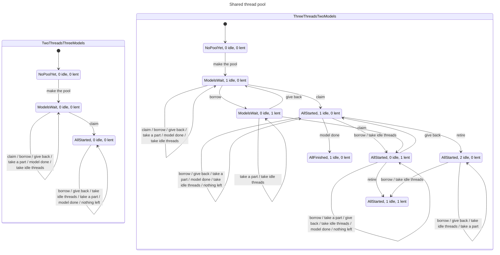
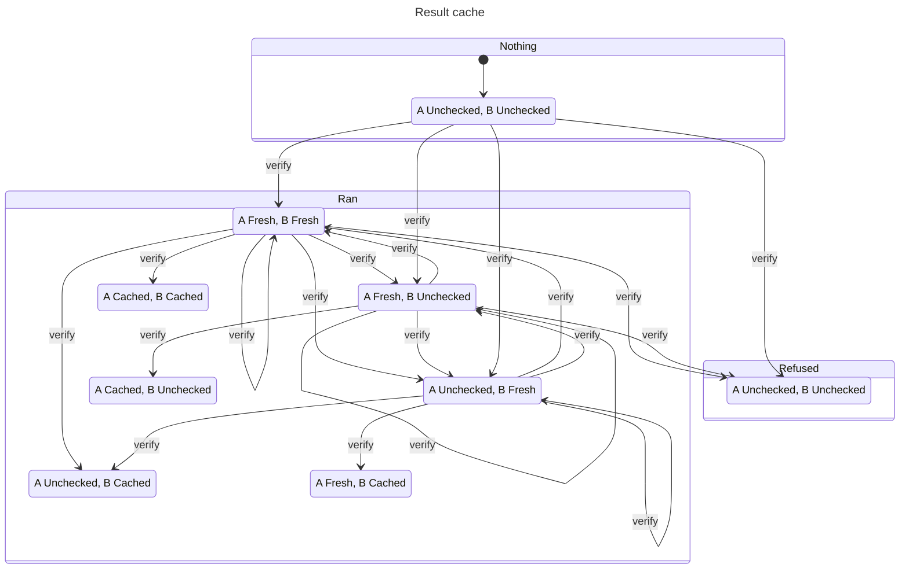
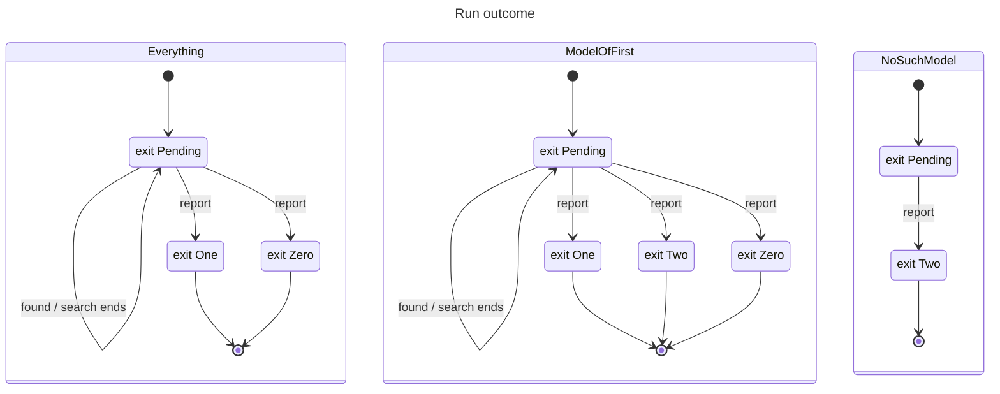

# Models of earnest, checked by earnest

Three of the checker's own state machines, written as Rust models with the `earnest` crate and
checked with `earnest verify`:

| File | Model | States | What it stands for |
|---|---|---|---|
| `src/pool.rs` | `Pool` | 35612 | The shared thread pool: `earnest_check::Helpers`, `apps/earnest/src/workers.rs` and the level loop of the search |
| `src/cache.rs` | `Cache` | 394 | The result cache: `apps/earnest/src/cache.rs`, `verify.rs` and the build fingerprint in `sources.rs` |
| `src/outcome.rs` | `Outcome` | 7222 | How a search becomes a result word, rule verdicts and an exit code: `earnest_check/src/report.rs`, `apps/earnest/src/print.rs`, `select.rs`, `verify.rs` |

Each model has two halves. The actions copy what the code does, function by function, and the
rules state what the contract (the root `README.md` and the doc comments) promises, written
against the inputs rather than against the code's own helpers, so a change to an action that
breaks a promise breaks a rule. Every rule below was broken on purpose by at least one wrong
version of an action (a mutation), listed per model.

Every model passes. Six rules that the code used to break were kept out of the files so that
they passed; each is now in its file and under "Fixed", with the path the checker printed
before the fix.

`cargo test -p earnest_models` runs two checks per model: `tests/verify.rs` runs `earnest verify
--json` on each file and asserts `pass`, the state count and every rule `holds`; and the
`#[cfg(test)]` module at the end of each file walks the model breadth first as plain Rust, with
`starts()` and `steps()`, and asserts the same count with no broken rule and no stuck state. The
second is the count from `rustc`'s reading of the file, the first from the checker's; they agree,
and `earnest confirm --tlc` gives the same count a third time.

## The thread pool (`src/pool.rs`)

### What each part stands for

| Model | Code |
|---|---|
| `setup` | `--jobs` and the number of models: two start states, 2 threads for 3 models and 3 threads for 2 models |
| `opened`, action `open` | `Pool::new` in `workers.rs`: a crew of `threads.min(tasks)` threads, `threads - crew` idle in `Helpers::new` |
| `idle` | the count in `Helpers` (`helpers.rs`) |
| `next`, action `claim`, action `find_none` | `Pool::claim`: `next.fetch_add(1)`, a task when it is below the number of tasks, else `None` |
| `claiming` | crew threads in the `while let Some(position) = pool.claim()` loop that are about to claim |
| `leaving`, action `retire` | a crew thread whose claim gave `None` and that has not yet run `pool.retire()`, which is `helpers.add(1)` |
| `a`, `b`, `c` (`Task`) | one model each; `phase` is `Absent` (no such model in this setup), `Waiting` (not yet claimed), `Between` (claimed, between two levels), `Spreading` (inside `expand_level`), `Done` |
| `Task.levels` | levels started, at most `MOST_LEVELS` = 2 |
| `Task.loan`, `Task.busy` | the threads the level has borrowed (the loans its workers hold) and the helper threads running parts of it: the same number, because a thread is only borrowed to start a worker |
| `Task.parts`, `Task.taken`, `Task.spread` | the parts `expand_level` cuts the level into (`cut_points` with at most `MOST_PARTS` = 64 parts, so 1 to 4 here, each a part of its own), how many a worker has taken, and whether the level is worth spreading (`Level`) or runs on one thread |
| `Task.polled` | the level has looked at the idle count since a thread last became idle, which every worker does before it takes a part (`take_up_idle_threads`) |
| action `start_level(job, parts, level)` | `expand_level` in `earnest_check/src/explore.rs`: when the level is worth spreading it starts its own worker and borrows one thread for each part beyond it, `min(idle, parts - own)` with `own = 1` (`run.rs` sets `jobs: 1`), so a borrowed thread always has a part |
| action `poll(job)` | `take_up_idle_threads`: a worker sees idle threads while parts are left, borrows one and starts a worker on it, as long as there are more parts left than workers |
| action `take_part(job)` | a worker takes the next part: `shared.next.fetch_add(1)`, after it polled |
| action `end_level(job)` | the last worker returning: the `Loan` of each worker is dropped when it finds no part left, which is `helpers.add(1)`; the model gives them all back at the end of the level, and a level that is not spread ends whenever |
| action `finish(job)` | `explore` returning to the crew thread's loop, which claims again |
| end `all_back` | every model done and `idle` is the whole `--jobs` |

`parts` stands for the number of parts, which `expand_level` makes from the size of the level
alone (`cut_points(len, len.div_ceil(64))`), not from the number of threads, so threads that
join late find parts left to take. `poll` and `take_part` are two steps so that a thread can
become idle between them; a thread that becomes idle (`retire`, `end_level`) clears `polled`,
because the levels have not seen it yet.

### Bounds

2 or 3 threads and 2 or 3 models are the smallest setups with each thing the code does: a
crew smaller than the models (so a model waits and starts late on a thread that finished
another), a crew smaller than the threads (so threads start idle and two models compete for
them), and a crew thread that retires while another model still runs. Two levels per model are
the fewest that let a model borrow, give back, and borrow again what another model left. A
level of 1 to 4 parts with 3 threads covers a level with fewer parts than threads, with as many
and with more.

### Rules

- `lent_once`: idle, lent, claiming, leaving and running threads add up to at most the total,
  so no thread is counted in two places. The `Helpers` count has no thread identities, so a
  thread lent to two models at once can only show as this sum going over the total.
- `none_lost`: once the pool is made, the same sum is at least the total.
- `own_thread`: the models running, plus the crew threads between models, are at most the crew,
  so every running model is on a crew thread of its own and never has zero threads.
- `none_idle_while_waiting`: while more models wait than crew threads are about to claim, no
  thread is idle or lent. A waiting model can only be started by a crew thread, so this is "no
  thread sits idle while a model waits with no one to start it".
- `runs_what_it_borrowed`: a level starts exactly as many helper threads as its loan, so no
  borrowed thread sits unused for the level.
- `borrows_what_it_can_share`: a level borrows no more threads than it has parts beyond its own.
- `none_idle_beside_a_level`: when a spread level has looked at the idle threads since the last
  one became idle, either no thread is idle or the level has no part left for another thread.
  A thread that becomes idle waits at most until the next part is taken, not until the next
  level; that is the strict form of "no thread sits idle while a spread level could use it" that
  a pool that looks at the idle count whenever it takes a part can keep.
- `finished_holds_nothing`: a finished model holds no loan.
- End `all_back`: every model is finished and every thread is back in `idle`. Any state where no
  action can happen and that is not this end is stuck. The model has no cycle (every action
  moves `next`, a phase or `levels` forward), so with no stuck state every run reaches this end:
  the checker has no liveness rule, and this is how the model states "every run can finish".

### States

35612, the same in `earnest verify` and in the `rustc` walk. Not derived by hand: the two
setups interleave up to three models with two levels each, a choice of level size and the parts
taken one by one, and an honest hand count of that is a program, which the `rustc` walk is.

### Mutations

| Wrong version | Caught by |
|---|---|
| `end_level` gives the loan back twice | `lent_once`, a stuck state, `idle` out of range |
| `start_level` lends without taking from `idle` | `lent_once`, a stuck state, `idle` out of range |
| `find_none` forgets the thread (never retires) | `none_lost`, a stuck state |
| `finish` drops the crew thread | `none_lost`, a stuck state |
| the crew is one thread (`let crew: u8 = 1;`) | `none_idle_while_waiting` |
| `claim` keeps the claiming thread counted | `lent_once`, `own_thread`, a field out of range |
| the level starts the helpers it wanted, not those it got | `runs_what_it_borrowed` |
| a model can finish in the middle of a level | `finished_holds_nothing`, a stuck state |
| a level borrows every idle thread | `borrows_what_it_can_share` |
| `poll` takes up no thread | `none_idle_beside_a_level` |

### Chart

Not shown: 1304 of 35612 states and 22 of 42 arrows.

## The result cache (`src/cache.rs`)

### What each part stands for

| Model | Code |
|---|---|
| action `run(flags)` | one `earnest verify` of one file with two models, `A` and `B`: `check_all` and `keep` in `verify.rs` |
| `Flags.source` | the file's content, `First` or `Second` |
| `Flags.max_states`, `Flags.timing` | `--max-states` (default or small), `--time-limit` (none, or set with each of `A` and `B` stopped by it or not) |
| `Flags.picked`, `Flags.only` | `--model B` and `--rule` naming a rule of `A` only; `--model B --rule` of `A` is refused (exit 2, `select.rs`) and leaves the cache alone |
| `Flags.build` | the binary: `Old`, `Rebuilt` (built again from the same sources) or `New` (other sources) |
| `Flags.caching` | `--no-cache`: the stored results are loaded but none is served |
| `Flags.noise` | what can't change a result: another `--jobs`, or a touched file (a new modification time with the same bytes) |
| `Key`, `key_of`, `fingerprint` | `cache::Key::new`: engine, file, source, max states, time limit in seconds and rule. `fingerprint` is `EARNEST_ENGINE` from `sources::engine`, the same for `Old` and `Rebuilt`. The file's path is the same in every run, so it is left out |
| `entry`, `stored_a`, `stored_b` | the one entry file for the path, `Entry { key, models }` |
| `loaded` | `Cache::load` (the stored models when the key is equal), in `entries`, also with `--no-cache` |
| `pass_for`, `Pass` | for one model: what was loaded, what is served (`is_result_of`, and not with `--no-cache`), and what is checked fresh |
| `kept`, `lasting` | `keep`: stored models without a fresh result, then fresh results that are not `has_time_limit() && stopped_by_time_limit(reason)` |
| `Made` | what a result was computed from: model, sources, content, state limit, rule, whether a time limit stopped it (`reason` starts with `time limit of`; a stop at the state limit is not that) |
| `asked`, `served_*`, `shown_*` | what the last run asked, and for each model whether it was cached, fresh or not checked, and the result shown |
| `lasting_*`, `due_*`, `forced` | the rules' own memory: the inputs of each model's last check that was not stopped early, whether this run should have been served, and whether it had `--no-cache` |

The rules compare `Made` and `Asked`, which come from the flags through `sources_of`, not from
the code's `Key`, so a key that leaves out an input breaks a rule.

### Bounds

Two values of each input that can change a result are enough: the cache compares keys for
equality, so a second value is the only thing that can make a key differ. Three builds are the
fewest that tell "the same sources rebuilt" from "other sources". Two models are the fewest for
`--model` and for a time limit that stops one model and not the other. One file, because the
entry is per path and the path is part of the key. The model has no end: a run can always
follow, and the state space closes because the state holds only the cache and the last run.

### Rules

- `served_for_the_same_input`: a cached result is served only for the same model, sources,
  content, state limit and rule, and never one a time limit stopped.
- `no_cache_checks_again`: a `--no-cache` run serves nothing from the cache.
- `timed_out_never_stored`: no stored result was stopped by a time limit.
- `reused_when_nothing_changed`: a model checked with exactly the inputs of its last check that
  was not stopped by a time limit (another `--jobs`, a touched file or a rebuilt binary are the
  same inputs) is served from the cache, unless a run since then had another key, which the
  single entry of a file cannot keep beside the new one, or was checked again by `--no-cache`.
  A run that does not check the model leaves its stored result alone, with `--no-cache` too,
  and a result that the state limit stopped is stored, with a time limit set or not.

### States

394, the same in `earnest verify`, in the `rustc` walk and in TLC. Not derived by hand: the
cache content after a run depends on the one before it, and the reachable pairs of entry and
last run are not a product of independent parts.

### Mutations

| Wrong version | Caught by |
|---|---|
| the key leaves out `--max-states` | `served_for_the_same_input` |
| the key leaves out `--time-limit` | `served_for_the_same_input`, `timed_out_never_stored` |
| the key leaves out `--rule` | `served_for_the_same_input` |
| the key leaves out the file's content | `served_for_the_same_input` |
| the key leaves out the engine | `served_for_the_same_input` |
| the engine is the binary, not its sources | `reused_when_nothing_changed` |
| `keep` stores a result a time limit stopped | `served_for_the_same_input`, `timed_out_never_stored` |
| `keep` drops a result that the state limit stopped when a time limit is set | `reused_when_nothing_changed` |
| `--no-cache` drops the stored results of the models the run did not check | `reused_when_nothing_changed` |
| `load` ignores `--no-cache` | `no_cache_checks_again` |
| `is_result_of` takes the other model's result | `served_for_the_same_input`, `reused_when_nothing_changed` |
| nothing is ever stored | `reused_when_nothing_changed` |
| the key holds `--jobs` or the modification time | `served_for_the_same_input`, `reused_when_nothing_changed` |
| `keep` drops the models it did not check | `reused_when_nothing_changed` |

### Chart

Not shown: 16 of 394 states and 46 of 66 arrows.

## The run outcome (`src/outcome.rs`)

### What each part stands for

| Model | Code |
|---|---|
| `first`, `second` | two files found by the run: a model file read with one model, an `unreadable` file, or a skipped test file (`discovery.rs`) |
| `selection` | no `--model`, `--model` naming a model the first file declares (read, or in an unreadable file whose declaration the reader got), or `--model` naming no model any file declares (`select.rs`) |
| `phase_*`, action `stop` | the search of the file's model: still searching, or ended at the last state, at `--max-states` or at `--time-limit` (`Search::run`, `reason`) |
| `found_*`, action `find` | what the search found so far: a broken rule (`first_broken`), a rule with no value in a state (`unjudged`), a stuck state, or a state cut short (out of range, or a fault of an action or end, `trouble`) |
| action `report`, `status`, `verdict` | `Search::outcome` in `earnest_check/src/report.rs`: `Fail` when a finding or a broken rule, else `Unfinished` at a limit, else `Pass`; a rule is `Broken` when seen broken, `Holds` when the search ended with no reason, the rule was judged everywhere and no state was cut short, else `Unknown` |
| `exit_code`, `not_passed`, `matched` | `Summary::everything_passed` in `print.rs` and the `refusing` error path of `verify`: exit 2 when `--model` matches no declared model, else 0 only with no `fail`, no `unfinished` and no unreadable file |
| `exit_without_skipped` | the exit code of the same run with the skipped test file deleted |
| `error_names_skipped` | the `refusing` sentence naming the skipped test file that holds the model |
| `error_names_unreadable` | the error of `select` naming the unreadable files that may declare the model, when none declares it |
| `word_*`, `verdict_*` | the printed status word (`Pending` when nothing is printed because of exit 2) and the one rule's verdict |

One rule per model is enough: verdicts are judged rule by rule. A rule that faults also makes a
`fault` finding, as in the code, and `CutShort` stands for every finding that stops the search
from going on from a state.

### Bounds

Two files are the fewest for "a skipped or unreadable file next to a model" and for `--model`
picking one of two. The search is abstract: the order in which it finds things and stops is
free, and every subset of the four findings with each of the three ways to end is reached.

### Rules

- `limit_with_broken_is_fail`: a checked model with anything found is `fail`, whether or not a
  limit stopped it (README: "One that already has a broken rule, a stuck state, a state out of
  range or a fault is `fail`").
- `limit_without_broken_is_unfinished`: a model stopped at a limit with nothing found is
  `unfinished`.
- `pass_only_when_whole`: `pass` only when the search ended at the last state with nothing
  found.
- `holds_only_when_judged`: a rule holds only when the search ended at the last state, the rule
  had a value in every state and no state out of range or fault in an action or an end cut the
  search short, so no counted state was left unjudged and no reachable one unreached.
- `broken_exactly_when_seen`: a checked rule is `broken` exactly when a counted state broke it.
- `exit_zero_only_when_all_passed`: exit 0 only when every checked model passed and no file was
  unreadable.
- `exit_one_when_something_is_wrong`: when the selection matched, exit 1 when a checked model did
  not pass or a file was unreadable.
- `exit_two_when_nothing_matched`: exit 2 exactly when `--model` names no model that any file
  declares, an unreadable file included.
- `skipped_never_changes_the_exit`: the exit code is the one the run would have with the skipped
  test file deleted.
- `named_skipped_file_is_reported`: `--model` naming a model that only a skipped test file holds
  is exit 2 and the error names the file.
- `named_unreadable_file_is_reported`: `--model` naming a model that an unreadable file declares
  is exit 1 and the file is reported as `unreadable`, with its problems.
- `unreadable_files_are_named_with_no_such_model`: `--model` naming no declared model while a
  file is unreadable is exit 2 and the error names the unreadable files, which may hold it.
- End `exited`: earnest has printed and exited.

### States

7222, derived by hand and the same in `earnest verify`, the `rustc` walk and TLC.

There are 3 x 3 x 3 = 27 start states. A file's model is searched when the selection matches
(no `--model`, or `--model` naming the first file's model and that file being a model file),
the file is selected (every file, or only the first) and the file is a model file. A searched
file goes through 16 sets of findings while searching and 3 x 16 = 48 after it stops: 64 states,
48 of them settled. With `r` searched files a start reaches `64^r` states before the report and
one reported state for each of the `48^r` settled combinations (a file that is not searched
stays at its start values):

| Selection | Starts | Searched files | States each | States |
|---|---|---|---|---|
| no `--model`, both model files | 1 | 2 | 4096 + 2304 | 6400 |
| no `--model`, one model file | 4 | 1 | 64 + 48 | 448 |
| no `--model`, no model file | 4 | 0 | 1 + 1 | 8 |
| `--model` of the first, first is a model file | 3 | 1 | 64 + 48 | 336 |
| `--model` of the first, first is not a model file (skipped, or unreadable and declaring it) | 6 | 0 | 1 + 1 | 12 |
| `--model` that names nothing | 9 | 0 | 1 + 1 | 18 |
| | 27 | | | 7222 |

### Mutations

| Wrong version | Caught by |
|---|---|
| a limit wins over what was found (`unfinished` with a broken rule) | `limit_with_broken_is_fail` |
| a stuck state is not a failure | `limit_with_broken_is_fail`, `pass_only_when_whole`, `exit_zero_only_when_all_passed`, `exit_one_when_something_is_wrong` |
| a rule holds although it faulted | `holds_only_when_judged` |
| a rule holds although a state was cut short | `holds_only_when_judged` |
| a rule holds at a limit | `holds_only_when_judged` |
| a stuck state makes a rule `broken` | `broken_exactly_when_seen` |
| `unfinished` exits 0 | `exit_zero_only_when_all_passed`, `exit_one_when_something_is_wrong` |
| an unreadable file exits 0 | `exit_zero_only_when_all_passed`, `exit_one_when_something_is_wrong` |
| a skipped test file counts as unreadable | `skipped_never_changes_the_exit` |
| `--model` reads the model of a skipped test file | `exit_two_when_nothing_matched`, `named_skipped_file_is_reported` |
| the error does not name the skipped file | `named_skipped_file_is_reported` |
| `--model` ignores the models an unreadable file declares (exit 2) | `named_unreadable_file_is_reported`, `exit_two_when_nothing_matched` |
| the error does not name the unreadable files | `unreadable_files_are_named_with_no_such_model` |
| `--model` that names nothing checks every model | `exit_two_when_nothing_matched` |

### Chart

## Findings

None is left open. Each finding was a rule the code broke, kept out of the file so that the
file passed; the six are fixed below.

## Fixed

Each was a finding: a rule the code broke, kept out of the file so that it passed. The rule is
now in the file and holds, the actions describe the changed code, and the state counts above
are those of the model with the rule.

### 1. A lent thread can run nothing (pool, fixed)

`runs_what_it_borrowed` states `==`, where it was `<=`. Before the fix it broke after `open`,
`claim`, `claim`, `start_level[A, 1 state, not worth spreading]`, `end_level[A]`, `finish[A]`,
`find_none`, `retire`, `start_level[B, 4 states, worth spreading]`: `idle: 2 -> 0`, `b.loan =
2`, `b.busy = 1`. `expand_level` borrowed `frontier.len() - own` threads and only then cut the
level in parts of `len.div_ceil(jobs)`, which are fewer than `jobs` when `len` is small next to
`jobs` (4 states over 3 jobs: 2 parts), so a lent thread was kept from every other model for the
whole level and ran nothing. Now `expand_level` works out the parts for the threads it could
get (`parts_of`), borrows only the threads those parts use and gives back at once any that a
race left over (`Loan::keep_at_most`). The model's `start_level` does the same, and the pool
has 1694 states, down from 1702: the levels that borrowed a thread to no use are gone.

### 2. Threads that come free in the middle of a level wait for the next level (pool, fixed)

The finding was the rule "no thread sits idle while a spread level could use it":
`self.idle == 0 || no task is Spreading with loan + 1 < states`. It broke after `open`, `claim`,
`claim`, `start_level[A, 2 states, not worth spreading]`, with `idle = 1` beside a level of 2
states that was running on one thread, and, once the levels that run on one thread are left
out, after `start_level[A, 1 state]`, `start_level[B, 3 states, worth spreading]`, `end_level[A]`,
`finish[A]`, `find_none`, `retire`: `idle: 0 -> 1` while `B` is in a level that wanted 2. A search
borrowed once per level, so threads that came free during a level went to the next level of
some model, which for a model with a few wide levels is most of its run. Measured with
`--jobs 4` on the 4-core container (`target/release/earnest verify --no-cache --jobs 4
tasks/models`, whole run): 15.2 to 16.3 s over 7 runs (one 10.8 s), against 6.3 to 6.5 s over 6
runs now, the time `Cache` takes alone.

Now `expand_level` cuts a level in at most 64 parts that do not depend on the number of
threads, starts one worker for each of its own threads, and each worker looks at the idle count
before it takes a part; when a thread is idle and parts are left, the worker borrows it and
starts another worker on it, which gives its thread back when it finds no part left. The parts
are merged in order, so the result is the same for every `--jobs`, every timing and every run.
The rule is in the model as `none_idle_beside_a_level`, with the actions `poll` and `take_part`;
without `poll` taking the idle threads it breaks, as `poll` that takes none shows in the
mutations. The strict form without `polled` cannot hold for any pool that looks at the idle
count at the parts' boundaries: a thread is idle from the moment it is freed to the next part
taken. 35612 states, up from 1694: each level now takes its parts one at a time.

### 3. `--no-cache --model` forgets the other models of the file (cache, fixed)

`reused_when_nothing_changed` no longer has its `--no-cache` exception: `lasting_after` kept a
model's last check only when `flags.caching == Caching::Used`, and the code behind it was
`entries` in `apps/earnest/src/verify.rs`, which loaded nothing under `--no-cache`, so `keep`
wrote the entry from the fresh results alone. Before the fix the rule broke after `run[all
models]`, `run[--model B --no-cache]`, `run[all models]`: `A` was checked again. Reproduced
with the binary: `verify two.rs`, `verify two.rs` (both cached), `verify --no-cache --model
Stove two.rs`, `verify two.rs`: `Oven` was no longer `(cached)`. Now `entries` loads the stored
results always and `check_all` serves none of them with `--no-cache`, so `keep` leaves the
results of the models the run did not check as they were. The model's `loaded` ignores
`--no-cache` and `pass_for` serves only when it is not given.

### 4. A state-limited result is not stored when a time limit is set (cache, fixed)

`reused_when_nothing_changed` no longer counts a state limit under a time limit as "stopped
early": `stopped_early` and `lasting` test `made.timed_out` alone. Before the fix it broke after
`run[--max-states small --time-limit, both finish]` twice: `A`, which stopped at the state limit
and not at the time limit, was checked again. `keep` stored a fresh result only when `!(key
.has_time_limit() && reason.is_some())`, and a state limit sets `reason` too. Now `keep` asks
`earnest_check::stopped_by_time_limit(reason)`, which is true for `time limit of N s` and false
for `state limit of N`. The search also says `time limit` when the clock cut short the last
judging of the states it had found (`judge_the_rest`), where it said `state limit` before and
left a result that depended on the clock. Reproduced and fixed: `verify --model Oven --rule
closed --max-states 1 --time-limit 100 two.rs` twice now prints `(cached)` the second time.
The model has 394 states, up from 330: the results that were never stored are stored now.

### 5. A rule `holds` in a model whose search was cut short (outcome, fixed)

`holds_only_when_judged` also requires that nothing cut the search short: `&&
!self.found(file).has(Found::CutShort)`. Before the fix it broke after `find[First, CutShort]`,
`stop[First, Exhausted]`, `report`: `word_first: Fail`, `verdict_first: Holds`. `Search::outcome`
gave `Holds` when there was no `reason` and the rule was never unjudged, so a state out of
range, which is counted and in which no rule is judged, left every rule `holds`; the same for a
fault in a condition, a change or an end, which leaves the states beyond it unreached. With the
binary: a `Climb` model whose action takes `n` from 0 to 3 in a `#[range(0, 2)]` field and the
rule `n < 3` printed `fail` with an `out-of-range` finding and the rule `"verdict": "holds"`.
Now the verdict is `unknown` there, in `earnest_check` (`Search::cut_short`, set by a state out
of range and by a fault that is not a rule's own, so another rule's fault does not take `holds`
from a rule that was judged everywhere) and in the Node library's `explore`, so the two agree.
`Verdict::Holds` and `Verdict::Unknown`, the README's definition of `unknown` and `earnest
confirm` say the same: where the checker reports a state out of range or a fault of an action or
an end, which TLC can not see, `confirm` accepts the checker's `unknown` against TLC's `holds`.
The model's `verdict` does the same and has the same 7222 states.

### 6. `--model` naming a model in an unreadable file says no such model exists (outcome, fixed)

`named_unreadable_file_is_reported` is in the file and holds: `--model` naming a model that an
unreadable file declares is exit 1 and the file is reported as unreadable with its problems.
Before the fix it broke at once from `selection = ModelOfFirst, first = Unreadable`: `report`
gave exit 2 and printed nothing about the file. `select` (`apps/earnest/src/select.rs`) only
looked at readable models, and `verify`, `chart`, `report`, `tla` and `confirm` printed `error:
no model is named `Lamp`` and exited 2. Now `ModelFile` keeps the models the reader declared
also for an unreadable file (the drafts of a TypeScript file; for a Rust file, the `#[derive(Model)]`
structs and their `#[rule]` methods, found with `syn`, because the Rust reader gives no draft
for an unreadable file), `select` lets a name or a rule that such a file declares through with
no model, and the command says `error: the model `Lamp` is declared in `lamp.rs`, which is
unreadable, so it was not checked` and goes on to list the file's problems, exit 1. A name that
no file declares is still exit 2, and the error now names the unreadable files, which may hold
it: `no model is named `Lamp`; the unreadable file `lamp.rs` may declare it`. The second rule,
`unreadable_files_are_named_with_no_such_model`, states that. The model's count is the same,
7222: no new state, only other exits.
