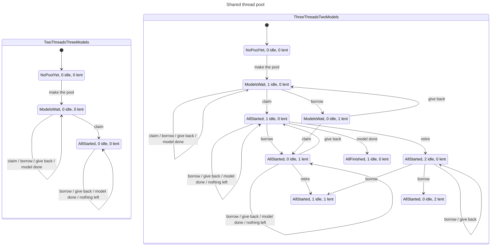
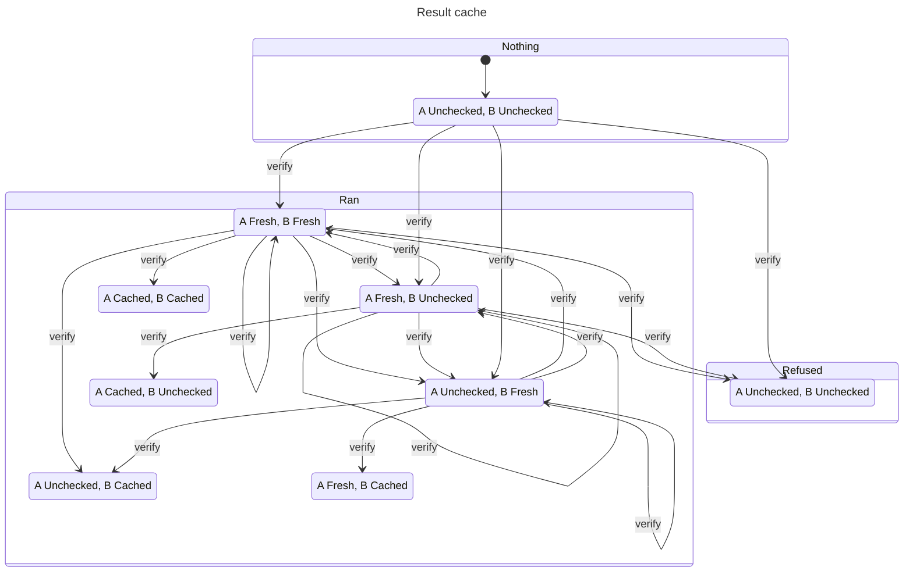
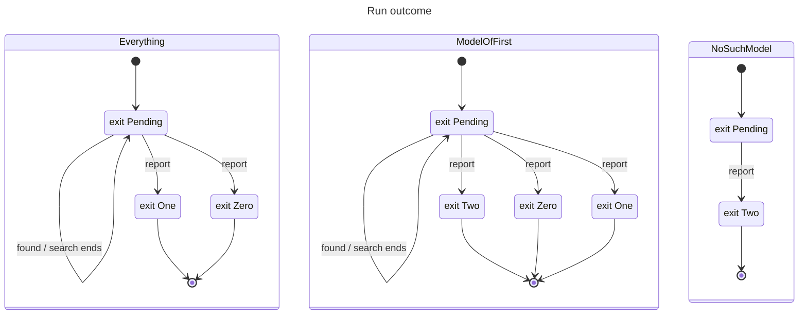

# Models of earnest, checked by earnest

Three of the checker's own state machines, written as Rust models with the `earnest` crate and
checked with `earnest verify`:

| File | Model | States | What it stands for |
|---|---|---|---|
| `src/pool.rs` | `Pool` | 1702 | The shared thread pool: `earnest_check::Helpers`, `apps/earnest/src/workers.rs` and the level loop of the search |
| `src/cache.rs` | `Cache` | 330 | The result cache: `apps/earnest/src/cache.rs`, `verify.rs` and the build fingerprint in `sources.rs` |
| `src/outcome.rs` | `Outcome` | 7222 | How a search becomes a result word, rule verdicts and an exit code: `earnest_check/src/report.rs`, `apps/earnest/src/print.rs`, `select.rs`, `verify.rs` |

Each model has two halves. The actions copy what the code does, function by function, and the
rules state what the contract (the root `README.md` and the doc comments) promises, written
against the inputs rather than against the code's own helpers, so a change to an action that
breaks a promise breaks a rule. Every rule below was broken on purpose by at least one wrong
version of an action (a mutation), listed per model.

Every model passes. Six rules that the code breaks are not in the files, because the crate's
test asserts that the files pass; each is under "Findings" with the change that brings it back
and the path the checker prints.

`cargo test -p earnest_models` runs two checks per model: `tests/verify.rs` runs `earnest verify
--json` on each file and asserts `pass`, the state count and every rule `holds`; and the
`#[cfg(test)]` module at the end of each file walks the model breadth first as plain Rust, with
`starts()` and `steps()`, and asserts the same count with no broken rule and no stuck state. The
second is the count from `rustc`'s reading of the file, the first from the checker's; they agree,
and `earnest confirm --tlc` gives the same count a third time.

## The thread pool (`src/pool.rs`)

### What each part stands for

| Model | Code |
|---|---|
| `setup` | `--jobs` and the number of models: two start states, 2 threads for 3 models and 3 threads for 2 models |
| `opened`, action `open` | `Pool::new` in `workers.rs`: a crew of `threads.min(tasks)` threads, `threads - crew` idle in `Helpers::new` |
| `idle` | the count in `Helpers` (`helpers.rs`) |
| `next`, action `claim`, action `find_none` | `Pool::claim`: `next.fetch_add(1)`, a task when it is below the number of tasks, else `None` |
| `claiming` | crew threads in the `while let Some(position) = pool.claim()` loop that are about to claim |
| `leaving`, action `retire` | a crew thread whose claim gave `None` and that has not yet run `pool.retire()`, which is `helpers.add(1)` |
| `a`, `b`, `c` (`Task`) | one model each; `phase` is `Absent` (no such model in this setup), `Waiting` (not yet claimed), `Between` (claimed, between two levels), `Spreading` (inside `expand_level`), `Done` |
| `Task.levels` | levels started, at most `MOST_LEVELS` = 2 |
| `Task.loan` | `Loan::threads()` of the level's loan |
| `Task.states`, `Task.busy` | `frontier.len()` of the level and the helper threads `expand_level` actually starts: `cut_points(len, len.div_ceil(jobs))` gives that many parts, less the model's own |
| action `start_level(job, states, level)` | `expand_level` in `earnest_check/src/explore.rs`: when the level is worth spreading it calls `helpers.borrow(len - own)` with `own = 1` (`run.rs` sets `jobs: 1`), which takes `min(idle, wanted)` |
| action `end_level(job)` | the `Loan` dropped at the end of `expand_level`, which is `helpers.add(loan)` |
| action `finish(job)` | `explore` returning to the crew thread's loop, which claims again |
| end `all_back` | every model done and `idle` is the whole `--jobs` |

`share` and `chunks` are `div_ceil` and the number of parts `cut_points` makes, written as
comparisons because the library has no division.

### Bounds

2 or 3 threads and 2 or 3 models are the smallest setups with each thing the code does: a
crew smaller than the models (so a model waits and starts late on a thread that finished
another), a crew smaller than the threads (so threads start idle and two models compete for
them), and a crew thread that retires while another model still runs. Two levels per model are
the fewest that let a model borrow, give back, and borrow again what another model left. A
level of 1 to 4 states with 3 threads covers every case of `cut_points`, including the one
where it makes fewer parts than there are threads (4 states over 3 threads: parts of 2).

### Rules

- `lent_once`: idle, lent, claiming, leaving and running threads add up to at most the total,
  so no thread is counted in two places. The `Helpers` count has no thread identities, so a
  thread lent to two models at once can only show as this sum going over the total.
- `none_lost`: once the pool is made, the same sum is at least the total.
- `own_thread`: the models running, plus the crew threads between models, are at most the crew,
  so every running model is on a crew thread of its own and never has zero threads.
- `none_idle_while_waiting`: while more models wait than crew threads are about to claim, no
  thread is idle or lent. A waiting model can only be started by a crew thread, so this is "no
  thread sits idle while a model waits with no one to start it".
- `runs_what_it_borrowed`: a level starts no more helper threads than its loan.
- `borrows_what_it_can_share`: a level borrows no more threads than it has states beyond its
  own.
- `finished_holds_nothing`: a finished model holds no loan.
- End `all_back`: every model is finished and every thread is back in `idle`. Any state where no
  action can happen and that is not this end is stuck. The model has no cycle (every action
  moves `next`, a phase or `levels` forward), so with no stuck state every run reaches this end:
  the checker has no liveness rule, and this is how the model states "every run can finish".

### States

1702, the same in `earnest verify`, in the `rustc` walk and in TLC. Not derived by hand: the
two setups interleave up to three models with two levels each and a choice of level size, and
an honest hand count of that is a program, which the `rustc` walk is.

### Mutations

| Wrong version | Caught by |
|---|---|
| `end_level` gives the loan back twice | `lent_once`, a stuck state, `idle` out of range |
| `start_level` lends without taking from `idle` | `lent_once`, a stuck state, `idle` out of range |
| `find_none` forgets the thread (never retires) | `none_lost`, a stuck state |
| `finish` drops the crew thread | `none_lost`, a stuck state |
| the crew is one thread (`let crew: u8 = 1;`) | `none_idle_while_waiting` |
| `claim` keeps the claiming thread counted | `lent_once`, `own_thread`, a field out of range |
| the level starts the helpers it wanted, not those it got | `runs_what_it_borrowed` |
| a model can finish in the middle of a level | `finished_holds_nothing`, a stuck state |
| a level borrows every idle thread | `borrows_what_it_can_share` |

### Chart

Not shown: 264 of 1702 states and 17 of 37 arrows.

## The result cache (`src/cache.rs`)

### What each part stands for

| Model | Code |
|---|---|
| action `run(flags)` | one `earnest verify` of one file with two models, `A` and `B`: `check_all` and `keep` in `verify.rs` |
| `Flags.source` | the file's content, `First` or `Second` |
| `Flags.max_states`, `Flags.timing` | `--max-states` (default or small), `--time-limit` (none, or set with each of `A` and `B` stopped by it or not) |
| `Flags.picked`, `Flags.only` | `--model B` and `--rule` naming a rule of `A` only; `--model B --rule` of `A` is refused (exit 2, `select.rs`) and leaves the cache alone |
| `Flags.build` | the binary: `Old`, `Rebuilt` (built again from the same sources) or `New` (other sources) |
| `Flags.caching` | `--no-cache` |
| `Flags.noise` | what can't change a result: another `--jobs`, or a touched file (a new modification time with the same bytes) |
| `Key`, `key_of`, `fingerprint` | `cache::Key::new`: engine, file, source, max states, time limit in seconds and rule. `fingerprint` is `EARNEST_ENGINE` from `sources::engine`, the same for `Old` and `Rebuilt`. The file's path is the same in every run, so it is left out |
| `entry`, `stored_a`, `stored_b` | the one entry file for the path, `Entry { key, models }` |
| `loaded` | `Cache::load` (the stored models when the key is equal) or nothing with `--no-cache`, in `entries` |
| `pass_for`, `Pass` | for one model: what was loaded, what is served (`is_result_of`), and what is checked fresh |
| `kept`, `lasting` | `keep`: stored models without a fresh result, then fresh results that are not `has_time_limit() && reason.is_some()` |
| `hits_state_limit` | `A` stops at the small state limit, `B` never does: the result has a `reason` |
| `Made` | what a result was computed from: model, sources, content, state limit, rule, whether a time limit stopped it |
| `asked`, `served_*`, `shown_*` | what the last run asked, and for each model whether it was cached, fresh or not checked, and the result shown |
| `lasting_*`, `due_*`, `forced` | the rules' own memory: the inputs of each model's last check that was not stopped early, whether this run should have been served, and whether it had `--no-cache` |

The rules compare `Made` and `Asked`, which come from the flags through `sources_of`, not from
the code's `Key`, so a key that leaves out an input breaks a rule.

### Bounds

Two values of each input that can change a result are enough: the cache compares keys for
equality, so a second value is the only thing that can make a key differ. Three builds are the
fewest that tell "the same sources rebuilt" from "other sources". Two models are the fewest for
`--model` and for a time limit that stops one model and not the other. One file, because the
entry is per path and the path is part of the key. The model has no end: a run can always
follow, and the state space closes because the state holds only the cache and the last run.

### Rules

- `served_for_the_same_input`: a cached result is served only for the same model, sources,
  content, state limit and rule, and never one a time limit stopped.
- `no_cache_checks_again`: a `--no-cache` run serves nothing from the cache.
- `timed_out_never_stored`: no stored result was stopped by a time limit.
- `reused_when_nothing_changed`: a model checked with exactly the inputs of its last check that
  was not stopped early (another `--jobs`, a touched file or a rebuilt binary are the same
  inputs) is served from the cache, unless a run since then had another key, or was a
  `--no-cache` run that did not check it. Those two exceptions, and "stopped early" including a
  state limit under a time limit, are narrower than the contract's sentence; see "Findings".

### States

330, the same in `earnest verify`, in the `rustc` walk and in TLC. Not derived by hand: the
cache content after a run depends on the one before it, and the reachable pairs of entry and
last run are not a product of independent parts.

### Mutations

| Wrong version | Caught by |
|---|---|
| the key leaves out `--max-states` | `served_for_the_same_input` |
| the key leaves out `--time-limit` | `served_for_the_same_input`, `timed_out_never_stored` |
| the key leaves out `--rule` | `served_for_the_same_input` |
| the key leaves out the file's content | `served_for_the_same_input` |
| the key leaves out the engine | `served_for_the_same_input` |
| the engine is the binary, not its sources | `reused_when_nothing_changed` |
| `keep` stores a result a time limit stopped | `served_for_the_same_input`, `timed_out_never_stored` |
| `load` ignores `--no-cache` | `no_cache_checks_again` |
| `is_result_of` takes the other model's result | `served_for_the_same_input`, `reused_when_nothing_changed` |
| nothing is ever stored | `reused_when_nothing_changed` |
| the key holds `--jobs` or the modification time | `served_for_the_same_input`, `reused_when_nothing_changed` |
| `keep` drops the models it did not check | `reused_when_nothing_changed` |

### Chart

Not shown: 8 of 330 states and 46 of 66 arrows.

## The run outcome (`src/outcome.rs`)

### What each part stands for

| Model | Code |
|---|---|
| `first`, `second` | two files found by the run: a model file read with one model, an `unreadable` file, or a skipped test file (`discovery.rs`) |
| `selection` | no `--model`, `--model` naming the first file's model, or `--model` naming no model that was read (`select.rs`) |
| `phase_*`, action `stop` | the search of the file's model: still searching, or ended at the last state, at `--max-states` or at `--time-limit` (`Search::run`, `reason`) |
| `found_*`, action `find` | what the search found so far: a broken rule (`first_broken`), a rule with no value in a state (`unjudged`), a stuck state, or a state cut short (out of range, or a fault of an action or end, `trouble`) |
| action `report`, `status`, `verdict` | `Search::outcome` in `earnest_check/src/report.rs`: `Fail` when a finding or a broken rule, else `Unfinished` at a limit, else `Pass`; a rule is `Broken` when seen broken, `Holds` when the search ended with no reason and the rule was judged everywhere, else `Unknown` |
| `exit_code`, `not_passed`, `matched` | `Summary::everything_passed` in `print.rs` and the `refusing` error path of `verify`: exit 2 when `--model` matches nothing, else 0 only with no `fail`, no `unfinished` and no unreadable file |
| `exit_without_skipped` | the exit code of the same run with the skipped test file deleted |
| `error_names_skipped` | the `refusing` sentence naming the skipped test file that holds the model |
| `word_*`, `verdict_*` | the printed status word (`Pending` when nothing is printed because of exit 2) and the one rule's verdict |

One rule per model is enough: verdicts are judged rule by rule. A rule that faults also makes a
`fault` finding, as in the code, and `CutShort` stands for every finding that stops the search
from going on from a state.

### Bounds

Two files are the fewest for "a skipped or unreadable file next to a model" and for `--model`
picking one of two. The search is abstract: the order in which it finds things and stops is
free, and every subset of the four findings with each of the three ways to end is reached.

### Rules

- `limit_with_broken_is_fail`: a checked model with anything found is `fail`, whether or not a
  limit stopped it (README: "One that already has a broken rule, a stuck state, a state out of
  range or a fault is `fail`").
- `limit_without_broken_is_unfinished`: a model stopped at a limit with nothing found is
  `unfinished`.
- `pass_only_when_whole`: `pass` only when the search ended at the last state with nothing
  found.
- `holds_only_when_judged`: a rule holds only when the search ended at the last state and the
  rule had a value in every state (README: "`unknown` (the rule was not seen broken, but the
  model was unfinished or the rule faulted in a state)").
- `broken_exactly_when_seen`: a checked rule is `broken` exactly when a counted state broke it.
- `exit_zero_only_when_all_passed`: exit 0 only when every checked model passed and no file was
  unreadable.
- `exit_one_when_something_is_wrong`: when the selection matched, exit 1 when a checked model did
  not pass or a file was unreadable.
- `exit_two_when_nothing_matched`: exit 2 exactly when `--model` names no model that was read.
- `skipped_never_changes_the_exit`: the exit code is the one the run would have with the skipped
  test file deleted.
- `named_skipped_file_is_reported`: `--model` naming a model that only a skipped test file holds
  is exit 2 and the error names the file.
- End `exited`: earnest has printed and exited.

### States

7222, derived by hand and the same in `earnest verify`, the `rustc` walk and TLC.

There are 3 x 3 x 3 = 27 start states. A file's model is searched when the selection matches
(no `--model`, or `--model` naming the first file's model and that file being a model file),
the file is selected (every file, or only the first) and the file is a model file. A searched
file goes through 16 sets of findings while searching and 3 x 16 = 48 after it stops: 64 states,
48 of them settled. With `r` searched files a start reaches `64^r` states before the report and
one reported state for each of the `48^r` settled combinations (a file that is not searched
stays at its start values):

| Selection | Starts | Searched files | States each | States |
|---|---|---|---|---|
| no `--model`, both model files | 1 | 2 | 4096 + 2304 | 6400 |
| no `--model`, one model file | 4 | 1 | 64 + 48 | 448 |
| no `--model`, no model file | 4 | 0 | 1 + 1 | 8 |
| `--model` of the first, first is a model file | 3 | 1 | 64 + 48 | 336 |
| `--model` of the first, first is not a model file | 6 | 0 | 1 + 1 | 12 |
| `--model` that names nothing | 9 | 0 | 1 + 1 | 18 |
| | 27 | | | 7222 |

### Mutations

| Wrong version | Caught by |
|---|---|
| a limit wins over what was found (`unfinished` with a broken rule) | `limit_with_broken_is_fail` |
| a stuck state is not a failure | `limit_with_broken_is_fail`, `pass_only_when_whole`, `exit_zero_only_when_all_passed`, `exit_one_when_something_is_wrong` |
| a rule holds although it faulted | `holds_only_when_judged` |
| a rule holds at a limit | `holds_only_when_judged` |
| a stuck state makes a rule `broken` | `broken_exactly_when_seen` |
| `unfinished` exits 0 | `exit_zero_only_when_all_passed`, `exit_one_when_something_is_wrong` |
| an unreadable file exits 0 | `exit_zero_only_when_all_passed`, `exit_one_when_something_is_wrong` |
| a skipped test file counts as unreadable | `skipped_never_changes_the_exit` |
| `--model` reads the model of a skipped test file | `exit_two_when_nothing_matched`, `named_skipped_file_is_reported` |
| the error does not name the skipped file | `named_skipped_file_is_reported` |
| `--model` that names nothing checks every model | `exit_two_when_nothing_matched` |

### Chart

## Findings

Each finding is a rule the code breaks. The rule is not in the file, so that the file passes;
the change below brings it back, and the path is what `earnest verify` printed with it.

### 1. A lent thread can run nothing (pool)

Rule: "every thread on loan runs a part of the level": in `runs_what_it_borrowed`, `<=` becomes
`==`. Broken after `open`, `claim`, `claim`, `start_level[A, 1 state, not worth spreading]`,
`end_level[A]`, `finish[A]`, `find_none`, `retire`, `start_level[B, 4 states, worth spreading]`:
`idle: 2 -> 0`, `b.loan = 2`, `b.busy = 1`.

`expand_level` (`crates/earnest_check/src/explore.rs`) borrows `frontier.len() - own` threads,
then cuts the level in parts of `len.div_ceil(jobs)`; `cut_points` gives
`ceil(len / ceil(len / jobs))` parts, which is fewer than `jobs` when `len` is small next to
`jobs` (4 states over 3 jobs: 2 parts). The loan keeps the threads it does not start from every
other model for the whole level, and `per_state` is scaled by `level.workers = jobs`, not by the
parts that ran. A level of 512 states, the smallest that is always spread, first loses a
thread at 28 jobs (parts of 19 give 27 parts); at 64 jobs, 600 states give 60 parts and keep 4
lent threads idle. Small levels spread because they are slow lose more. A code fault in
the use of the pool, not a lost thread.

### 2. Threads that come free in the middle of a level wait for the next level (pool)

Rule: "no thread sits idle while a spread level could use it". Add the rule
`self.idle == 0 || no task is Spreading with 0 < loan and loan + 1 < states`. Broken after
`open`, `claim`, `claim`, `start_level[A, 1 state]`, `start_level[B, 3 states, worth
spreading]` (B borrows the one idle thread), `end_level[A]`, `finish[A]`, `find_none`, `retire`:
`idle: 0 -> 1` while `B` is in a level that wanted 2.

This is the design: a search borrows once per level (`Helpers` doc: "borrows what is idle when
it starts a level and gives it back when the level is done"). The root `README.md` says "when a
model finishes and no model waits to start, its threads go to the models still running"; they
go only when that model starts its next level, which for a model with a few wide levels is most
of its run. Measured on this crate with `--jobs 4`: `Cache` alone takes 6.1 s, and 15.2 s when
`pool.rs` and `outcome.rs` are in the same run, though those two finish in under 0.1 s. A
design question: the contract sentence promises more than the per-level loan gives.

### 3. `--no-cache --model` forgets the other models of the file (cache)

Rule: `reused_when_nothing_changed` without its `--no-cache` exception: in `lasting_after`,
drop `flags.caching == Caching::Used &&`. Broken after `run[all models]`, `run[--model B
--no-cache]`, `run[all models]`: `A` is checked again (`served_a: Fresh`) though every input is
the same as in the first run.

`entries` in `apps/earnest/src/verify.rs` loads nothing under `--no-cache`, and `keep` writes the
entry from that empty `stored` plus the fresh results, so the stored results of the models the
run did not check are dropped. Reproduced with the binary: `verify two.rs`, `verify two.rs`
(both cached), `verify --no-cache --model Stove two.rs`, `verify two.rs` (Oven is no longer
`(cached)`). A code fault that costs a re-check, never a wrong result.

### 4. A state-limited result is not stored when a time limit is set (cache)

Rule: `reused_when_nothing_changed` without its state-limit exception: in `lasting_after`, the
test becomes `made.timed_out`. Broken after `run[--max-states small --time-limit, both finish]`
twice: `A`, which stopped at the state limit and not at the time limit, is checked again.

`keep` stores a fresh result only when `!(key.has_time_limit() && reason.is_some())`, and a state
limit sets `reason` too. Reproduced: `verify --model Oven --rule closed --max-states 1
--time-limit 100 two.rs` twice prints no `(cached)`; without `--time-limit` the second run is
cached. Conservative and safe; a design question whether it is meant.

### 5. A rule `holds` in a model whose search was cut short (outcome)

Rule: `holds_only_when_judged` also requiring that nothing cut the search short: add
`&& !self.found(file).has(Found::CutShort)`. Broken after `find[First, CutShort]`,
`stop[First, Exhausted]`, `report`: `word_first: Fail`, `verdict_first: Holds`.

`Search::outcome` (`crates/earnest_check/src/report.rs`) gives `Holds` when there is no `reason`
and the rule was never unjudged; a state out of range is counted, "no rule is judged in it, and
nothing is explored from it". So a counted state the rule was never asked about leaves it
`holds`. With the binary: a `Climb` model whose action takes `n` from 0 to 3 in a `#[range(0,
2)]` field and the rule `n < 3` prints `fail` with an `out-of-range` finding and the rule
`"verdict": "holds"`, though the one state that breaks it is counted. `Verdict::Holds` is
documented as "True in every reachable state" and `Unknown` as "not judged in every state". The
root README lists only "unfinished or the rule faulted" for `unknown`, so code and README agree
with each other and disagree with the verdict's own doc. A contract gap.

### 6. `--model` naming a model in an unreadable file says no such model exists (outcome)

Rule: "an unreadable file that holds the model `--model` names is reported as unreadable".
Broken at once from `selection = ModelOfFirst, first = Unreadable`: `report` gives exit 2 and
prints nothing about the file.

`select` (`apps/earnest/src/select.rs`) only looks at readable models, and the error path of
`verify` prints `error: no model is named `Lamp`` and exits 2. `refusing` names a skipped test
file that holds the model, but nothing names an unreadable file, although the root README says
"it is never left out without a word". Reproduced with a file holding `struct Lamp` and a `loop`.
A contract gap: exit 2 with a sentence that is false about the file the user meant.
